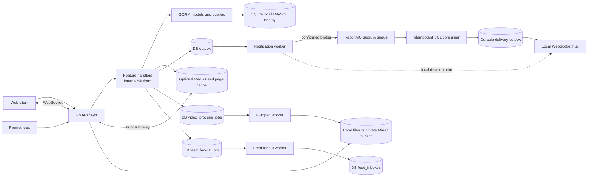

# GoStream architecture

## Current implementation

GoStream is a single-process modular monolith. One Go API handles accounts, social graph, videos, feeds, interactions, notifications, search, media, and messaging. Feature code lives under `internal/platform`; handlers currently call GORM directly. Separate Domain, Application, and Infrastructure packages remain a planned refactor.

`cmd/gostream` loads configuration, opens SQLite or MySQL, calls `internal/migrations` for frozen v001 SQL, v002 outbox indexing, v003 Feed fanout tables and the v004 pull index/backfill, backfills existing message-device records once, and starts the HTTP server, outbox worker, Feed fanout worker, upload cleanup, message-device cleanup, media reconciliation, optional FFmpeg worker, optional Redis subscriber, optional RabbitMQ consumer, and optional pprof listener. Workers join before broker/database resources close on normal signal shutdown. Numbered migrations use fixed SQL snapshots for DDL; v004 checks the current column/index before replaying its additive statements. `internal/platform/server.go` owns routing, JWT middleware, CORS, readiness and shared server state. `uploads.go` and `uploads_object.go` handle resumable sessions, `media_store.go` selects MinIO operations and same-origin media reads, `device.go` manages message-device registration and expiry, `video_processing.go` handles durable transcode jobs, `feed_fanout.go` and `following_feed.go` handle bounded inbox writes and push/pull reads, `media_reconcile.go` removes old unregistered media and unused registered assets, `outbox.go` handles notification dispatch, `metrics.go` registers bounded route labels, `hub.go` owns the local WebSocket registry, and `realtime.go` relays events across instances. The web client is static HTML/CSS/JavaScript under `web/`.

The default local SQLite profile reduces setup for learning and publishes uploaded files immediately unless `FFMPEG_BIN` is set. Its persistent file uses WAL, a five-second busy timeout, and foreign-key checks. WebSocket tests use the same SQLite profile in a disposable file, so concurrent reads and writes exercise the local runtime settings. The MySQL/Redis Compose profile has been started and exercised with real API requests, including FFmpeg processing. Redis provides a short-lived Feed page cache. The optional `docker-compose.object.yml` overlay adds MinIO; two API replicas with separate filesystems have completed a shared upload session and served its processed video and cover from the bucket. RabbitMQ is enabled in Compose and optional through `RABBITMQ_URL` elsewhere. Its consumer commits a unique delivery-outbox row before ACK, and publisher confirms gate source completion; [transport and recovery](RABBITMQ.md) details the tested failure boundaries.

In object mode, a 4 MiB chunk is stored under a hash-qualified `chunks/<session>/<index>/<sha256>` key before its unique SQL row is inserted. Competing replicas can upload without overwriting each other's bytes; SQL chooses the accepted hash. A retry hashes any existing object and repairs missing or same-size corrupted bytes before reporting success. Completion holds a conditional database lease, streams and rehashes every chunk into a temporary file, uploads `media/<session>.<extension>`, then commits the asset and completed status together. A retry sees the completed session. FFmpeg workers download the source and upload outputs before the SQL publication transaction; only a committed `published` row enters Feed. Failed or superseded output is deleted best effort, and hourly reconciliation removes old unreferenced objects after a grace period. Public URLs stay `/media/<generated-name>`; the API serves the private bucket with Range support. `/ready` checks SQL, not MinIO availability. The offline `cmd/gostream-media` tool scans asset, video, avatar and unfinished-job SQL media references plus live upload chunks, and copies/verifies local files before switching the same database to object mode. It also backs up every object under `media/` and `chunks/` with SHA-256 and Content-Type in a manifest, and restores missing objects into a new bucket only after checking the complete local backup and destination conflicts. SQL and objects are not one atomic snapshot; the documented recovery procedure stops application writers while both are copied.

## Feed choices

Timeline and following Feed use deterministic keyset pagination (`created_at`, then `id`) and apply the same ordering to every page. Hot uses the explainable interaction score `3*likes + 5*comments + 4*favorites`. Recommendation adds time buckets, followed-author affinity, and recently interacted-author affinity to that score; it is a rule-based baseline, with no topic model or author-diversity control. Its cursor carries a time anchor so recency weights remain fixed while paging. Following Feed merges a durable follower inbox with an indexed pull branch for high-follower authors, unfinished jobs and legacy posts, plus an indexed late-follow range. The threshold still defaults to zero: the latest full-size MySQL fixture shows an improvement but misses the 20% P95 acceptance target. [The Feed design](FEED_HYBRID.md) documents its consistency rules and [`PERFORMANCE.md`](PERFORMANCE.md) records both comparisons.

Anonymous timeline/recommend/hot pages and each authenticated viewer's following first page can be cached in Redis for five seconds. The key includes scene, viewer ID, page size, cursor hash, and a shared version; following pages also include a viewer-specific follow version. Publishing, editing, deletion, interactions, comments, and author display changes advance the shared version after a successful database write. Follow and unfollow advance only that viewer's follow version. Authenticated non-following pages and following cursor pages query the database. Redis errors use the database path; a failed invalidation may leave an old page visible until its TTL expires.

## Reliability boundaries

Outbox claims increment `attempts` as a lease generation. A completion or retry update succeeds only while that generation still owns a live lease, so an expired worker cannot overwrite a newer worker's published or dead-letter state. Delivery remains at least once across a lease handoff; the SQL inbox and event IDs support recovery and deduplication.

Likes/favorites and follows use database transactions; comments and their denormalized count are committed together. Notification rows and their outbox events are inserted in the same transaction. A worker leases source events and, in broker mode, records completion after confirmed RabbitMQ routing. The consumer creates an idempotent `notification.deliver` row; the same leased worker dispatches these delivery rows to local sockets and Redis. Local development without a broker dispatches source rows directly. Both stages have bounded retries and dead states. Offline notifications remain in the database inbox. The direct-message handler commits each message and notification before acknowledging the originating socket. The local hub keeps up to eight connections per user on each API instance and broadcasts committed direct/group events to active devices; ACK, error, pong, and reconnect replay stay on the initiating connection. Recipient ACK is persisted, and reconnect replays up to 100 unacknowledged direct and group messages. Direct history uses message-ID keyset pages; the web client ACKs the incoming rows it displays, including older pages. A browser-profile device UUID selects per-device direct receipts and group read cursors for unread paging and reconnect replay; clients without an ID keep the earlier account-level state. Groups use membership checks, durable messages, and per-member read cursors. Same-group sends acquire the group row lock before ID allocation and hold it through commit, preventing a lower-ID insert from committing behind a later cumulative ACK; this does not order post-commit socket delivery. With `REDIS_ADDR`, committed direct/group messages and outbox notifications are published to a Redis channel; each API instance delivers only to its own sockets after checking SQL records and group membership. Other devices of the sender also receive committed message echoes. Pub/Sub is best effort. Group history and direct unread APIs recover missed events beyond the replay limit. Redis sorted sets hold expiring per-node online entries; without Redis, presence is process-local. The last local disconnect persists last-seen time.

The notification inbox also uses ID keyset pages. The browser keeps the newest ID from its first page and supplies it when marking notifications read. The update is scoped to that user and ID boundary, so a notice assigned a higher ID after the page load remains unread. A legacy request without the boundary still marks all currently unread rows.

Search uses separate descending-ID cursors for users and published videos. A shared `LIKE ... ESCAPE '!'` pattern gives SQLite and MySQL literal matching for `%`, `_`, and `!`. Page size is bounded to 50 per type, and video results include batched viewer interaction flags. The web client loads the two result types independently and renders video cards with playback. Leading-wildcard substring queries scan candidate text rather than using a full-text index; a dedicated search index is future work for larger catalogs.

## Security and operations

Device-specific read state has its own lifecycle. A user row lock serializes new device registrations across instances; new registrations are capped at 32 IDs per account. At capacity, a new ID can replace the oldest one after 30 idle days. The hourly cleanup removes IDs idle for 90 days and deletes their direct receipts and group cursors in the same transaction. Original direct messages are retained, so a returning expired device may see duplicates rather than losing pending messages. A per-device lookup refreshes last-seen time at most once per minute while it is used.

Passwords use bcrypt; JWT uses `JWT_SECRET`, and video publication/edit/deletion checks ownership. Upload sessions use random IDs, fixed-size chunks, hashes, and a completion lease. Pending chunks are outside the public media directory. Basic media signature checks are present; the optional FFmpeg worker uses ffprobe to enforce duration/dimension limits before decoding, then transcodes and generates a thumbnail before a video enters public Feed. It stores output duration and dimensions with publication. `/health` checks the process, `/ready` pings the database, and `/metrics` exposes Prometheus counters/histograms. In-process, loopback SQLite, and one-host Compose MySQL/Redis Feed measurements, including authenticated following first pages, are documented. k6 and multi-host load tests remain pending.
