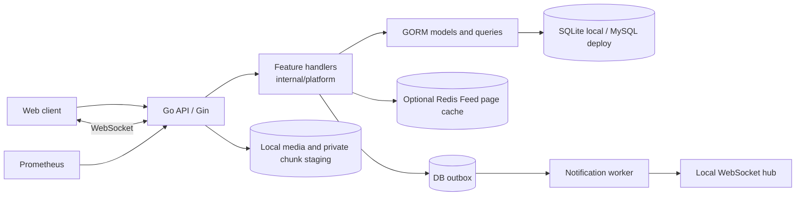

# GoStream architecture

## Current implementation

GoStream is a single-process modular monolith. One Go API handles accounts, social graph, videos, feeds, interactions, notifications, search, media, and messaging. Feature code lives under `internal/platform`; handlers currently call GORM directly. Separate Domain, Application, and Infrastructure packages remain a planned refactor.

`cmd/gostream` loads configuration, opens SQLite or MySQL, migrates GORM models, and starts the HTTP server, outbox worker, upload cleanup, and optional pprof listener. `internal/platform/server.go` owns routing, JWT middleware, CORS, readiness and shared server state. `uploads.go` handles resumable sessions, `outbox.go` handles notification dispatch, `metrics.go` registers bounded route labels, and `hub.go` owns the local WebSocket registry. The web client is static HTML/CSS/JavaScript under `web/`.

The default local SQLite profile reduces setup for learning. The MySQL adapter is configured but has not been container tested here. Compose includes Redis for a short-lived anonymous Feed cache. RabbitMQ, object storage, and video processing are not wired into this version.

## Feed choices

Timeline and following Feed use deterministic keyset pagination (`created_at`, then `id`) and apply the same ordering to every page. Recommendation and hot currently use the explainable but unbounded score `3*likes + 5*comments + 4*favorites`; there is no freshness decay, personalization, or author diversity yet. Following Feed joins the follow relation to published videos. A later hybrid fanout stage can push recent videos into follower inboxes for ordinary creators and pull from author outboxes for high-follower creators. Its threshold and batch size should be configurable and benchmarked before claiming an optimization.

Anonymous timeline/recommend/hot pages can be cached in Redis for five seconds. The key includes scene, page size, cursor hash, and a shared version. Publishing, editing, deletion, interactions, comments, and author display changes advance the version after a successful database write. Authenticated and following pages query the database. Redis errors use the database path; a failed invalidation may leave an old page visible until its TTL expires.

## Reliability boundaries

Likes/favorites and follows use database transactions; comments and their denormalized count are committed together. Notification rows and their outbox events are inserted in the same transaction. A worker atomically leases ready events, attempts local WebSocket delivery, and records completion or a retry/dead-letter state. Offline notifications remain in the database inbox. The direct-message handler commits each message and notification before acknowledging the sender. Recipient ACK is persisted, and reconnect replays up to 100 unacknowledged direct messages. Groups use membership checks, durable messages, and per-member read cursors. Group socket fanout and online presence are local to the current process; disconnects persist last-seen time.

## Security and operations

Passwords use bcrypt; JWT uses `JWT_SECRET`, and video publication/edit/deletion checks ownership. Upload sessions use random IDs, fixed-size chunks, hashes, and a completion lease. Pending chunks are outside the public media directory. Basic media signature checks are present; FFmpeg transcoding remains. `/health` checks the process, `/ready` pings the database, and `/metrics` exposes Prometheus counters/histograms. A local benchmark is measured; no k6 latency or QPS is claimed.
