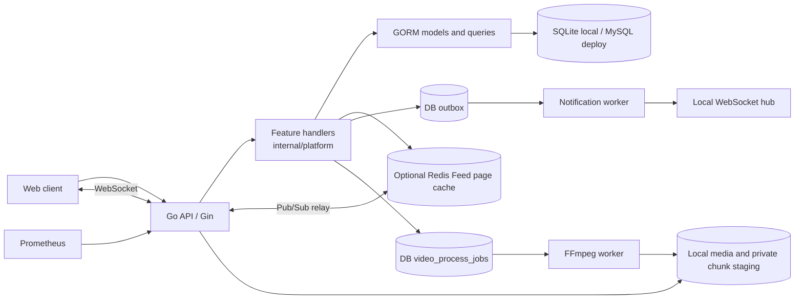

# GoStream architecture

## Current implementation

GoStream is a single-process modular monolith. One Go API handles accounts, social graph, videos, feeds, interactions, notifications, search, media, and messaging. Feature code lives under `internal/platform`; handlers currently call GORM directly. Separate Domain, Application, and Infrastructure packages remain a planned refactor.

`cmd/gostream` loads configuration, opens SQLite or MySQL, migrates GORM models, and starts the HTTP server, outbox worker, upload cleanup, optional FFmpeg worker, optional Redis subscriber, and optional pprof listener. `internal/platform/server.go` owns routing, JWT middleware, CORS, readiness and shared server state. `uploads.go` handles resumable sessions, `video_processing.go` handles durable transcode jobs, `outbox.go` handles notification dispatch, `metrics.go` registers bounded route labels, `hub.go` owns the local WebSocket registry, and `realtime.go` relays events across instances. The web client is static HTML/CSS/JavaScript under `web/`.

The default local SQLite profile reduces setup for learning and publishes uploaded files immediately unless `FFMPEG_BIN` is set. The MySQL/Redis Compose profile has been started and exercised with real API requests, including FFmpeg processing. Redis provides a short-lived Feed page cache. RabbitMQ and object storage are not wired into this version.

## Feed choices

Timeline and following Feed use deterministic keyset pagination (`created_at`, then `id`) and apply the same ordering to every page. Hot uses the explainable interaction score `3*likes + 5*comments + 4*favorites`. Recommendation adds time buckets, followed-author affinity, and recently interacted-author affinity to that score; it is a rule-based baseline, with no topic model or author-diversity control. Its cursor carries a time anchor so recency weights remain fixed while paging. Following Feed joins the follow relation to published videos. A later hybrid fanout stage can push recent videos into follower inboxes for ordinary creators and pull from author outboxes for high-follower creators. Its threshold and batch size should be configurable and benchmarked before claiming an optimization.

Anonymous timeline/recommend/hot pages and each authenticated viewer's following first page can be cached in Redis for five seconds. The key includes scene, viewer ID, page size, cursor hash, and a shared version; following pages also include a viewer-specific follow version. Publishing, editing, deletion, interactions, comments, and author display changes advance the shared version after a successful database write. Follow and unfollow advance only that viewer's follow version. Authenticated non-following pages and following cursor pages query the database. Redis errors use the database path; a failed invalidation may leave an old page visible until its TTL expires.

## Reliability boundaries

Likes/favorites and follows use database transactions; comments and their denormalized count are committed together. Notification rows and their outbox events are inserted in the same transaction. A worker atomically leases ready events, attempts local WebSocket delivery, and records completion or a retry/dead-letter state. Offline notifications remain in the database inbox. The direct-message handler commits each message and notification before acknowledging the sender. Recipient ACK is persisted, and reconnect replays up to 100 unacknowledged direct and group messages. Groups use membership checks, durable messages, and per-member read cursors. With `REDIS_ADDR`, committed direct/group messages and outbox notifications are published to a Redis channel; each API instance delivers only to its own sockets after checking SQL records and group membership. Pub/Sub is best effort. Group history and direct unread APIs recover missed events beyond the replay limit. Redis sorted sets hold expiring per-node online entries; without Redis, presence is process-local. Disconnects persist last-seen time.

## Security and operations

Passwords use bcrypt; JWT uses `JWT_SECRET`, and video publication/edit/deletion checks ownership. Upload sessions use random IDs, fixed-size chunks, hashes, and a completion lease. Pending chunks are outside the public media directory. Basic media signature checks are present; the optional FFmpeg worker performs actual media decoding, transcoding and thumbnail generation before a video enters public Feed. `/health` checks the process, `/ready` pings the database, and `/metrics` exposes Prometheus counters/histograms. In-process, loopback SQLite, and one-host Compose MySQL/Redis Feed measurements, including authenticated following first pages, are documented. k6 and multi-host load tests remain pending.
