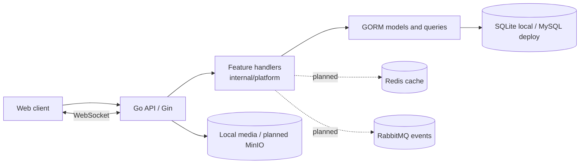

# GoStream architecture

## Current implementation

GoStream is a single-process modular monolith. A single Go API handles accounts, social graph, videos, feeds, interactions, notifications, search and messaging. The first vertical slice is organized by feature under `internal/platform`; handlers currently call GORM directly. Separate Domain, Application, and Infrastructure packages are a planned refactor, not a current property of the code.

`cmd/gostream` loads environment configuration, opens SQLite or MySQL, migrates GORM models, and starts the HTTP server with bounded headers and graceful shutdown. `internal/platform/server.go` owns routing, JWT middleware, CORS and shared server state. Feature handlers and models live beside it in `internal/platform/{accounts,videos,feed,social,notifications,messages,models}.go`; `hub.go` owns the process-local WebSocket registry. The web client is static HTML/CSS/JavaScript under `web/`.

The default local SQLite profile is a deliberate onboarding choice, not a claim that SQLite is the production scaling target. The MySQL adapter keeps the schema path portable. Redis, RabbitMQ, object storage and video processing are not wired into this version.

## Feed choices

Timeline and following Feed use deterministic keyset pagination (`created_at`, then `id`) and apply the same ordering to every page. Recommendation and hot currently use the explainable but unbounded score `3*likes + 5*comments + 4*favorites`; there is no freshness decay, personalization, or author diversity yet. Following Feed joins the follow relation to published videos. A later hybrid fanout stage can push recent videos into follower inboxes for ordinary creators and pull from author outboxes for high-follower creators. Its threshold and batch size should be configurable and benchmarked before claiming an optimization.

## Reliability boundaries

Likes/favorites and follows currently use database transactions; comments and their denormalized count are also committed together. Unique constraints make follow, action, notification and client-message writes idempotent. `outbox_events` is only a schema placeholder: there is no asynchronous publisher/consumer yet. The single-process WebSocket handler persists a message before acknowledging the sender, then attempts immediate delivery to an online recipient. Recipient ACK is separately persisted.

## Security and operations

Passwords use bcrypt; JWT uses `JWT_SECRET`, and video deletion checks ownership. Uploads use generated names and a 250 MiB request cap. MIME probing and media transcoding are not implemented. Health currently checks only the HTTP process; database readiness and metrics remain future work. Load-test results are added with actual runs, not estimated values.
