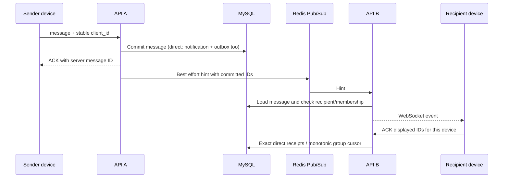

# IM persistence, delivery and recovery

## Scope and data flow

IM is part of the production API. Each process owns its WebSocket connections; MySQL stores direct/group messages, memberships, device receipts and group cursors. Redis relays committed IDs to other processes and stores expiring presence entries. RabbitMQ currently transports notifications, not IM message bodies.



Local recipients and the sender's other local devices are also reached by the process-local hub. ACK, error, pong and initial replay frames stay on their originating socket. Each API currently allows eight sockets per account.

## Guarantees and limits

| Mechanism | Implemented behavior | Limit |
| --- | --- | --- |
| Sender retries | Unique `(sender_id, client_id)` within each direct/group table; an exact retry returns the original ID; changed content is rejected | Preserve the same client ID until the application accepts its ACK |
| Real-time relay | Other instances load committed SQL rows and check current recipient/group membership | Pub/Sub events can be missed or repeated; reconnecting the subscriber does not republish missed hints |
| Recovery | Reconnect replays up to 100 direct and 100 group rows, then emits `sync_required` / `group_sync_required`; unread/history APIs page the rest | Clients must explicitly synchronize missed data and deduplicate by server ID |
| Direct device ACK | Exact unique `(user, device, message)` receipts; batch ownership is checked before writes | Legacy account-level ACK still suppresses replay on all devices |
| Group device ACK | Monotonic per-group/user/device cursor, starting from the account join/read baseline | ACK means every message through that ID is read; clients must synchronize gaps before advancing it |
| History order | Descending server-ID keyset pages; reconnect/unread direct pages ascend by ID | Same-group sends serialize ID allocation and commit; there is no cross-group commit order or live arrival order guarantee |
| Presence | Local hub plus expiring Redis node entries; Redis failure falls back to local visibility | Configured refresh is 30 seconds and node expiry 75 seconds; this test does not wait through a full crashed-node expiry |
| Device retention | New IDs capped at 32; 30-day idle eviction and 90-day expiry remove device-specific state, retaining messages | Continuously active devices' exact receipts are not compacted yet |

Group removal locks the group row, deletes that member's records and removes device cursors. In-flight sends re-verify membership under the group row lock and are rejected if revocation committed; ACK transactions verify active membership before writing device or shared cursors. Remote group hints recheck current SQL membership before dispatch. Data already delivered before removal cannot be recalled. The server commit-order and member-revocation regressions below are separate from the process matrix. The web client currently loads only the latest 100 group rows and ACKs live rows directly; backlog paging and gap-safe cumulative ACK handling remain a known client defect (P1-09).

## Same-group transaction ordering

`sendGroupMessage` locks its `chat_groups` row with `SELECT ... FOR UPDATE` before inserting a message, retaining the lock until commit or rollback. Invitations already lock this row before choosing the join baseline. Thus a later send in the same group cannot allocate and commit a higher ID while an earlier insertion is uncommitted. Different groups use different row locks. SQLite retains its database write serialization; the row-lock fault test specifically requires MySQL.

Without this lock, a real MySQL two-connection test paused ID 1 after insertion, committed and ACKed ID 2, then committed ID 1. Both rows existed, but unread returned zero at cursor 2. The lock prevents this late commit behind a cumulative cursor. No schema change or message ID rewrite is required. This does not repair already advanced cursors from earlier versions; affected users can retrieve retained rows through history.

```sh
# Use a dedicated MySQL schema, migrated with the project's migration tests.
# GOSTREAM_TEST_MYSQL_DSN must be configured for that disposable schema.
go test -race ./internal/platform -run '^TestMySQLGroupCommitOrder$' -count=3 -v
```

The test uses two independently connected servers and real WebSocket/HTTP routes. A test-only GORM callback pauses after the first SQL insert; production binaries have no fault switch. It checks commit and rollback blocking, independent groups, unread after ACKing the lower ID, and same-client-ID retries. Existing MySQL CI discovers it via `^TestMySQL`. Without the DSN it skips, which is not acceptance evidence.

A hot group now waits on its own database row; no throughput improvement is claimed. Committed rows can still be delivered in a different order because fanout happens after the transaction. Cumulative group ACK requires the client to have synchronized all earlier rows; this change does not provide exact group receipts.

### Group membership revocation and in-flight sends/ACKs

`removeGroupMember` acquires `SELECT id FROM chat_groups WHERE id = ? FOR UPDATE` inside its deletion transaction to serialize against concurrent invitations and message sends. `sendGroupMessage` re-checks that the sender is still a member (`tx.Where("group_id = ? AND user_id = ?", e.GroupID, userID).First(&currentMember)`) under the group row lock, returning `group not found` if revocation committed ahead of insertion. `ackGroupMessage` wraps its cursor updates in a transaction that re-checks active membership before creating or updating `GroupDeviceRead` / `GroupRead`, returning 404 (`group membership not found`) if the member has been removed. Sequential and permission checks run in `TestGroupMemberRevocationPermissions`; concurrent serialization runs under MySQL in `TestMySQLGroupMemberRevocationRace`.

## Real process verification

Run on Linux with Go 1.27.2, a C compiler for the race detector, Docker and an existing MySQL 8.4 container exposing its root password internally:

```sh
python3 tests/integration/im_smoke.py \
  --go-bin /usr/local/go/bin/go \
  --mysql-container gostream-mysql-1 \
  --mysql-addr 127.0.0.1:3307
```

The launcher creates a random schema/user and a disposable Redis 8.2.9 container on an explicit temporary port. It builds the actual API with `-race` and runs the Go matrix with `-race`. The matrix starts two independent API processes, each with its own SQL/Redis clients, media directory and TCP listener. Their HTTP/WebSocket routes and background workers are the production executable's normal startup path. Logs report process PIDs and verify the OS exit signal is actually SIGKILL. Graceful exits must return zero and child logs are checked for race reports.

| Scenario | Checked result |
| --- | --- |
| Concurrent duplicate send and permissions | Two API sockets return the same committed direct ID; conflicting content is rejected; group retries keep one row; a third account cannot read private history, ACK someone else's message or send/read a nonmember group |
| Repeated Redis hints | Two direct and two group hints reach the socket with the same stored IDs; SQL row counts do not change; repeat device ACK inserts no second receipt |
| Redis stop/start | Remote live hints are absent while SQL ACK, unread and history remain available; presence becomes local; two subscribers reconnect and new direct/group events also echo to the sender's other device |
| API SIGKILL | Kill the recipient process, commit while it is down, restart and replay; commit a sender message, kill its process before the test application uses the ACK, then retry the same key on the other instance and keep one ID |
| Backlog and ACK | Generate 105 direct and 105 group messages offline; check both 100-row replay caps and sync markers, complete unread/history pages, descending history IDs, device-specific ACKs and the other device's remaining backlog |
| Membership removal | Confirm a later group hint reaches the owner's remote device; the removed member receives none in the observation window and gets 404 for history/unread and a socket error for sending |

The five subtests combine these rows. Tests initially refuse nonempty SQL schemas and Redis data. Only a container in the explicit `gostream-im-test-` namespace can be stopped. The Go command runs in a separate Linux session. The launcher owns that process group and stops surviving descendants before deleting Redis or SQL credentials; it first sends SIGTERM, then uses bounded SIGKILL fallback. All Go temporary directories live inside the owned work directory. It prints remaining active test-process and schema/user counts. This cleanup also handles a Go test timeout, which skips `t.Cleanup`. No demonstration tables or Redis keys are used. Ordinary `go test ./...` skips this external matrix when configuration is absent. CI's independent `im-integration` job runs this same entry point.

CI also deliberately times out after the first production API becomes ready:

```sh
python3 tests/integration/im_smoke.py \
  --go-bin /usr/local/go/bin/go \
  --mysql-container gostream-mysql-1 \
  --mysql-addr 127.0.0.1:3307 \
  --check-timeout-cleanup
```

This mode pauses only the test process, expects Go's ten-second timeout, and verifies the intended startup marker. Successful launcher cleanup leaves zero active test processes, schemas and users. The nonzero inner Go result is intentional; the outer script succeeds only after cleanup. A separate final process-group check rejects surviving descendants. Disabling the cleanup function during local verification made this regression check fail, then the probe explicitly stopped its owned API.

Direct invocation of `TestIMProcessRecovery` requires all of `GOSTREAM_TEST_IM_BINARY`, `GOSTREAM_TEST_IM_MYSQL_DSN`, `GOSTREAM_TEST_IM_REDIS_ADDR`, and `GOSTREAM_TEST_IM_REDIS_CONTAINER`. Prefer the launcher, which constructs all four from disposable resources. Running tests against an active demonstration database is not supported.

## Evidence and remaining A07 work

Local execution used Go 1.27.2, MySQL 8.4.11, Redis 8.2.9 and WSL2 Linux x86_64; actual run results are in [`PROGRESS.md`](../PROGRESS.md). Test duration is correctness-check runtime, not a message latency or capacity measurement. This work does not claim the 20-client/1,000-message performance gate has passed.

A07 remains partial pending the final two-browser/full-component workflow, web group backlog/gap synchronization, concurrent membership revocation, full presence-expiry fault observation, long-lived active-device receipt compaction and the prescribed load run. Device eviction/expiry have separate existing SQLite/MySQL tests; this process matrix does not simulate 90 days. RabbitMQ commit/confirm/ACK kill windows remain separate A06 work. A disconnect can produce duplicate real-time events; SQL history and receipts, with client synchronization, provide recovery.

## Code reading order

1. [`hub.go`](../internal/platform/hub.go): authenticate, persist, ACK, local fanout and replay.
2. [`realtime.go`](../internal/platform/realtime.go): committed-ID relay, membership checks, reconnect and presence.
3. [`messages.go`](../internal/platform/messages.go), [`groups.go`](../internal/platform/groups.go): pagination and receipt/cursor semantics.
4. [`device.go`](../internal/platform/device.go): registration cap and idle cleanup.
5. [`recovery_test.go`](../tests/integration/im/recovery_test.go), [`helpers_test.go`](../tests/integration/im/helpers_test.go), [`im_smoke.py`](../tests/integration/im_smoke.py): public-protocol fault assertions, real process ownership and resource isolation.
