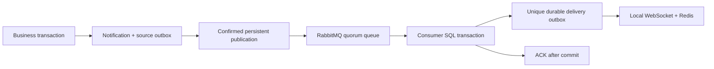

# RabbitMQ notification delivery

Notifications support RabbitMQ 4.3.7 using the RabbitMQ-maintained `amqp091-go` v1.15.0 client. The real MySQL/broker failure matrix has run locally, including real API process kills at consumer commit/pre-ACK and producer post-confirm/pre-SQL windows, a sustained outbox stream, DLQ capacity backpressure/recovery, and a real API publish/consume while one non-leader quorum follower is offline followed by replica recovery. A06 remains partially accepted: three-node follower loss, leader failover and majority-loss outbox recovery have passed locally; longer-duration behavior, final combined deployment and remote CI remain open. Execution evidence belongs in [`PROGRESS.md`](../PROGRESS.md).

## Data flow and guarantees

The business transaction continues to write the notification inbox and `notification.created` outbox row together. In broker mode the outbox publisher sends a persistent, versioned event with its stable event key, mandatory routing and publisher confirms. Only a confirmed, routed publication can mark that source outbox row published.

The consumer validates the envelope against the committed source row and notification. Its transaction inserts a `notification.deliver` outbox row with unique key `broker-delivery:<source-event-key>`. This row is both the durable consumer effect and its deduplication record. The consumer ACKs only after commit. Redelivery after commit but before ACK finds the same row. The existing leased worker dispatches delivery rows to local sockets and Redis; these rows are never republished to RabbitMQ. No schema migration or second volatile task queue is needed.



Real-time delivery remains at least once. A delivery worker can send before losing its lease, so a later attempt can repeat a socket/Redis hint. SQL inbox/history remain authoritative. Consumer idempotency means one durable delivery row, not exactly-once WebSocket display.

## Queue and failure contract

One database uses one configured queue namespace. All its API workers must use the same broker configuration. The durable direct exchange routes to a bounded durable quorum queue. A durable quorum dead-letter queue is bound before source declaration. Source arguments select `reject-publish`, at-least-once dead lettering, a delivery limit of eight, and RabbitMQ 4.3's failed-delivery retry delay (one-second minimum, thirty-second maximum). A transient SQL failure uses `basic.reject(requeue=true)` so it counts as a failed delivery; malformed/conflicting events are rejected without requeue. A database failure must not be ACKed.

Publisher and consumer use separate connections. Publication has bounded network I/O and confirmation waits; uncertain outcomes are retried with the same event ID. Consumers reconnect and redeclare topology after disconnect. Startup with an unavailable broker leaves the HTTP API available and retries in the existing SQL outbox. `/ready` retains its database-only contract. SQL outbox attempts remain bounded at eight; dead SQL rows and broker dead letters require explicit operator replay after the cause is fixed.

SQLite without `RABBITMQ_URL` or `RABBITMQ_URLS` retains direct SQL-outbox dispatch for quick development. Compose enables broker delivery by default. A one-node Compose quorum queue survives a broker process restart but does not provide multi-node availability. Queue definitions are versioned names; changing immutable queue arguments requires an explicit queue migration. Deduplication rows must be retained while broker replay remains possible.

## Configuration and operations

| Setting | Behavior |
| --- | --- |
| `RABBITMQ_URLS` | Optional comma-separated list of `amqp://` or `amqps://` broker URIs for failover. Preferred over `RABBITMQ_URL`; publisher and consumer rotate their starting endpoint and try each address with a two-second per-endpoint connection deadline. Use the same credentials, vhost and TLS settings for every node; percent-encode commas within URI components. |
| `RABBITMQ_URL` | Optional single `amqp://` or `amqps://` URI, retained for local development and compatibility. Used when `RABBITMQ_URLS` is empty; empty values keep direct SQL-outbox dispatch. Credentials are excluded from broker errors. |
| `RABBITMQ_QUEUE` | Defaults to `gostream.notifications.v1`; 1–100 ASCII letters, digits, dots, underscores or hyphens; cannot start with `amq.`. Use a separate namespace for each database. |
| `RABBITMQ_PASSWORD` | Compose broker password; the documented default is for local development. Override with a URL-safe generated value, for example hexadecimal. Existing RabbitMQ volumes retain their user credentials. |

Compose exposes AMQP on `127.0.0.1:5672` and management on `127.0.0.1:15672`. The broker data has its own named volume. The isolated object-test overlay removes broker host ports so it can run alongside the demo; APIs use the Compose network. Publisher and consumer connections have separate lifecycles; the application handles reconnects rather than enabling the client's experimental recovery feature. Shutdown cancels and joins workers before closing the publisher and database.

Monitor `gostream_rabbitmq_messages_total{result="published|accepted|duplicate|retry|dead|reconnect"}`, `gostream_rabbitmq_connected{role="publisher|consumer"}`, existing outbox metrics, queue depth and the `.dead` queue. The publisher connection gauge records its last observed state, not an active dependency probe. `accepted`/`duplicate` count committed consumer outcomes; a subsequent ACK failure can still cause redelivery. `dead` counts explicit invalid-event rejections; retry exhaustion is visible in the broker DLQ, not that counter.

Two `published_at` values have different meanings: a source row records confirmed broker acceptance; a delivery row records completion of the local/Redis dispatch attempt. Neither means a user has read or ACKed a WebSocket message. The SQL notification inbox is available independently of both.

After fixing a failed dependency or poison event, an operator can use the shipped executable:

```sh
# Reset exactly one dead, unpublished SQL event. Active/published rows are refused.
docker compose exec api /usr/local/bin/gostream-events -outbox-key notification:42

# Republish at most ten DLQ entries, confirm each publication, then ACK that entry.
docker compose exec api /usr/local/bin/gostream-events -dead-letters 10
```

Outside Compose, run `go run ./cmd/gostream-events` with the same flags. SQL replay requires explicit `DB_DRIVER` and `DB_DSN` for an existing migrated database; DLQ replay requires `RABBITMQ_URLS` or `RABBITMQ_URL` and the correct queue namespace. This is a local operator command, not a public HTTP endpoint. It does not migrate a database. Replaying a permanently invalid envelope sends it back to the DLQ, so inspect and fix the cause first. Interrupted replay can publish twice; the unique delivery key makes this safe for the durable effect. Replay does not reset an already completed delivery job, and intentionally does not remove deduplication records.

## Executed tests and reproduction

With Go 1.27.2 and a running MySQL 8.4 container whose internal environment contains `MYSQL_ROOT_PASSWORD`:

```sh
python3 tests/integration/rabbitmq_smoke.py \
  --go-bin /usr/local/go/bin/go \
  --mysql-container gostream-mysql-1 \
  --mysql-addr 127.0.0.1:3307
```

The script creates a random schema/user and a disposable RabbitMQ 4.3.7 container with explicit temporary host ports. It migrates the schema, runs `TestRabbitMQNotificationIntegration` with the race detector, builds and starts the real API, and exercises worker recovery and both operator commands. Its pre-ACK scenario routes a real API through the test-only TCP proxy, waits until the production consumer's `basic.ack` frame is held, confirms the notification and unique delivery outbox row are committed, then SIGKILLs the API. A direct-broker restart must record a duplicate delivery, keep exactly one notification and delivery row, finish dispatch, and drain the RabbitMQ queue. Cleanup removes its broker, schema, user and temporary files. It never writes demo tables. Docker access and network access to pull the pinned image are required. CI's `rabbitmq-integration` job runs the same script against a dedicated MySQL service.

The real Go matrix checks:

- Confirmed publication before a missing SQL completion update, consumer commit before lost ACK, one delivery job and the actual WebSocket notification.
- Two consumers processing sixteen concurrent duplicate deliveries: one accepted effect and fifteen duplicates.
- An unbound mandatory route refusing source completion, followed by topology recovery.
- Invalid envelopes reaching a persistent quorum DLQ.
- A transient SQL failure recovering after delayed retry; persistent SQL failure exhausting its delivery limit and recovering through confirmed DLQ replay.
- Broker stop/start while a committed SQL event remains pending, followed by reconnection and delivery.

Direct Go invocation needs `GOSTREAM_TEST_RABBITMQ_URL` and `GOSTREAM_TEST_RABBITMQ_MYSQL_DSN` pointing to a dedicated migrated schema with an empty outbox. `GOSTREAM_TEST_RABBITMQ_CONTAINER` optionally names a **disposable** container the test is allowed to stop/start; without it, the restart subcase skips. The script supplies all three. Ordinary Go suites skip this matrix when external configuration is absent. SQLite unit tests separately cover strict envelopes, conflicting duplicates, rollback, cancellation, unavailable broker errors and targeted SQL replay.

The initial integration baseline passed its seven subcases in 48.12 seconds; API lifecycle and operator checks passed and cleanup reported zero remaining schemas/users. These are historical correctness timings, not a throughput benchmark. The first fixture failed because it asserted a deliberately hidden notification field; another attempt exposed Docker's randomly allocated host port changing on restart. The fixture now checks public notification fields and explicitly binds ports, retaining its state and recovery assertions.

The 2026-11-06 review caught `RABBITMQ_URLS` bypassing the pre-ACK proxy after endpoint-list support was added. Both URL settings now switch together. The corrected complete local smoke passed in173.992s, including both SIGKILL windows,300 sustained events over29.138s and a1.328s drain, and DLQ-capacity recovery. A real cancellation experiment also caught Python selectors swallowing an InterruptedError signal exception: launchers now share a custom non-OSError cancellation exception. All15 diagnostics tests passed; real MySQL/broker creation followed by SIGTERM exited143 and cleaned schema/user/broker/network/API in2.206s. SIGKILL or exhaustion of the outer cleanup grace can still prevent cleanup. Final-code CI and branch decisions are recorded in [the review](BRANCH_REVIEW_2026-11-06.md).

## Remaining acceptance work

The smoke script kills a real API after a committed follow request and verifies restart recovery, drains finite and 30-second sustained outbox workloads, gates both producer and consumer fault windows on observable states, and covers an unavailable/unbound DLQ target plus a capacity-limited DLQ recovery. Its `--rabbitmq-cluster --cluster-only` mode creates a disposable three-node cluster, takes one non-leader follower offline, verifies the production API completes a follow notification through source publish and consumer delivery outboxes, restarts the node and checks all replicas return online. The separate `--cluster-leader-only` mode stops the queue leader, verifies a replacement is elected, then requires API source and delivery completion through the configured broker endpoint list. `--cluster-majority-only` stops two members, requires the API request to commit its source event in SQL without a broker confirm or delivery side effect, restores a second member, and verifies that the outbox completes before the last node returns. These tests do not cover long-duration behavior or a broker cluster under load. The final combined MySQL/Redis/RabbitMQ/MinIO browser workflow remains unverified. No MQ throughput or exactly-once real-time delivery claim is made. Broker transport currently handles notifications; IM history/ACK and group hints retain SQL/Redis.

## Primary references

- [Publisher confirms in Go](https://www.rabbitmq.com/tutorials/tutorial-seven-go)
- [Consumer acknowledgements and confirms](https://www.rabbitmq.com/docs/confirms)
- [Quorum retry, delivery limits and at-least-once dead lettering](https://www.rabbitmq.com/docs/quorum-queues)
- [Pinned client release](https://github.com/rabbitmq/amqp091-go/releases/tag/v1.15.0)


## 2026-10-30 fault-test revision

New coverage pauses the isolated broker, observes a claimed/unpublished SQL event, kills/restarts the API and drains 50 finite events. The SQL claim is not proof of entry into a publisher-confirm wait. A separate test repeats a successful broker publication before SQL source completion, without claiming a real disconnect. The DLQ test now observes the production consumer reject the original poison while the target is unbound, restores the binding and checks that same ID before a second poison. It also fixes an erroneous `*gorm.DB != nil` check that previously made backlog polling always fail. Exact post-confirm/pre-SQL and consumer-commit/pre-ACK process-kill windows, sustained traffic and full DLQ remain outstanding.

Quorum at-least-once dead lettering is configured to retain messages until target confirmation; test scope follows the [RabbitMQ quorum queue documentation](https://www.rabbitmq.com/docs/quorum-queues#dead-lettering). Results require the actual broker CI, not SQLite unit tests.

The isolated test broker overrides `dead_letter_worker_publisher_confirm_timeout` to 1,000ms and verifies its actual application setting. Production RabbitMQ 4.3.7 defaults to 180,000ms; target recovery can wait for that retry timer. The test preserves original-message identity and keeps the target unbound across multiple short retries. This does not measure the production recovery latency. Source: [RabbitMQ 4.3.7 configuration](https://github.com/rabbitmq/rabbitmq-server/blob/v4.3.7/deps/rabbit/Makefile).


## 2026-10-31 三分支审核后的补充覆盖

`test/broker-fault-boundaries` 的有效增量在集成审核后保留并增强，不能据此删除上方待验项。

- `consumer_commit_pre_ack_disconnect_and_redelivery`：真实 AMQP Get 后调用生产持久接收方法提交 MySQL，再直接关闭底层 TCP，未发送 AMQP Close/ACK；新会话核对相同 ID/正文与 Redelivered 标志，再让生产消费者重投去重，检查 duplicate 指标、单一 SQL 行及停止消费者后的空队列。这是确定性的连接中断组件验证，未强杀生产 API。
- `confirmed_publish_before_sql_completion_retry`：确认发布后保留 SQL 未完成状态，重发相同 key 并核对去重指标。没有在真实生产者进程的 post-confirm/pre-SQL 时刻暂停或强杀。
- Go 混合矩阵：20 个独立有效事件通过两个 publisher 连接提交，5 个毒消息进入 DLQ；核对每个持久接收身份、全部互不重复的毒消息 ID、持久性与 rejected 原因。该用例验证接收，不单独宣称通知实时派发完成。
- Python API/worker 场景：在事务中准备 source 和可选去重行，source 已标记发送以免与后台发布者争抢；管理 API 发布后必须 routed=true。预提交去重场景检查生产消费者 duplicate 指标；混合场景并发发布 10 个独立有效 ID 和 3 个毒消息，逐 ID 检查实际 delivery 完成。检查全部 DLQ 身份/正文/原因后重新入队供运维 CLI，要求精确 replayed=3 及队列状态。夹具预置不等同于 pre-ACK 崩溃。
- SQLite 矩阵：32 次有效调用（16 个身份各重复两次）与 16 个毒消息同时启动；单连接串行写，检查 created/duplicate 各 16、毒消息拒绝、每个 SQL 身份恰一行。不能把单写池称为 MySQL 并行事务证明。

发布端 post-confirm/pre-SQL 精确强杀、满/不可用 DLQ、持续负载仍待完成；消费端 commit/pre-ACK 强杀已有真实 API 验证，详见下方 2026-11-05 记录。最终 MySQL/Redis/RabbitMQ/MinIO 联合配置也未关闭。真实组件执行以 CI 的 `rabbitmq-integration` 结果为准；本地结果不能替代远程 CI 通过记录。


## 2026-11-05 consumer commit/pre-ACK process-kill

The Python smoke runner now starts the production API with its RabbitMQ URL pointed at a test-only TCP proxy. The proxy parses AMQP 0-9-1 frames in the client-to-broker direction and withholds one `basic.ack` after being armed. It forwards other frames, including heartbeats, and does not add production hooks. The runner creates one real follow notification, waits for the proxy to observe that ACK and for MySQL to contain its unique `notification.deliver` row, then verifies one notification before sending SIGKILL to the API. It closes the proxy, restarts the API against RabbitMQ directly, and requires the production consumer's duplicate metric to increase, the single delivery row to finish dispatch, the notification and delivery row counts to remain one, and the queue to drain.

The final local consumer rerun on Go 1.27.2, MySQL 8.4.11, RabbitMQ 4.3.7, WSL2 Linux x86_64 (16 logical CPUs, 13 GiB RAM) completed in 117.878 seconds with exit code 0 and no timeout. The runner reported `consumer_pre_ack_process_kill=true`, `remaining_schema=0`, `remaining_user=0`, and `remaining_api=false`; task timing data is under the ignored `data/diagnostics/rabbitmq-a06-preack-rerun-20261105.json`. The separate temporary MySQL test container was removed after collecting this result. The proxy's framing/withholding behavior also passes `python3 -m unittest discover -s tests/integration -p test_rabbitmq_ack_proxy.py -v`; CI now runs this helper test in the quality job.

## 2026-11-05 producer post-confirm/pre-SQL process-kill

The smoke runner pauses the isolated broker until the real API claims a source outbox row, then opens a separate MySQL transaction and locks that row. After unpausing RabbitMQ, it waits for the API's `published` metric (incremented only after the publisher confirm) and for the production consumer to create the delivery row. It then observes the API SQL connection waiting on the locked source row through `performance_schema.data_lock_waits`; this establishes that confirm returned and the worker reached the `published_at` update. The runner SIGKILLs the API at that point, verifies the source row remains unpublished, releases the test lock, and restarts the API. The repeated publish uses the same event key; the restarted consumer counts a duplicate, the source becomes published on a later attempt, only one notification/delivery row remains, and the queue drains.

The Go 1.27.2/MySQL 8.4.11/RabbitMQ 4.3.7 local run completed in 126.108 seconds with exit code 0 and no timeout. Both `producer_post_confirm_process_kill=true` and `consumer_pre_ack_process_kill=true` were reported; the Go real-broker race matrix passed all twelve subtests in 60.23 seconds. Cleanup reported zero test schemas/users and no API child, and the isolated MySQL and broker containers were removed. Timing data is under ignored `data/diagnostics/rabbitmq-a06-producer-postconfirm-20261105.json`. This verifies the local single-node fault window, not long-duration or multi-node availability.

## 2026-11-05 sustained outbox stream

With the production API workers connected to real MySQL and RabbitMQ, the smoke runner inserted 30 batches of ten notification/outbox pairs at one-second intervals. It then checked that all 300 source rows had `published_at`, all 300 unique `notification.deliver` rows had completed dispatch, exactly 300 notifications existed, there were no dead SQL outbox rows, and the broker queue was empty. The 29.151-second arrival stream drained in 6.097 seconds after the final batch. This uses SQL-created fixtures to exercise the real outbox publisher, broker consumer and delivery worker; it does not measure API write QPS or claim a throughput limit.

The local Go 1.27.2/MySQL 8.4.11/RabbitMQ 4.3.7 run completed in 160.019 seconds with exit code 0 and no timeout. The 12 Go race subtests passed in 60.29 seconds, both process-kill markers remained true, and the runner reported `sustained_source_events=300`, `sustained_injection_seconds=29.151`, `sustained_drain_seconds=6.097`, `remaining_schema=0`, `remaining_user=0` and `remaining_api=false`. The isolated MySQL and broker containers were removed. Timing data is under ignored `data/diagnostics/rabbitmq-a06-sustained-outbox-20261105.json`. This is a local correctness/drain observation, not a performance benchmark.

## 2026-11-05 DLQ capacity backpressure and recovery

The smoke runner installs an exact-name operator policy on the disposable broker before the production API declares its quorum DLQ, limiting it to one message. It fills that target, sends two malformed envelopes through the real production consumer, and verifies the source queue retains poison while the DLX publisher cannot complete. RabbitMQ may accept one in-flight dead-letter publication while the bounded target is saturated, so the test records and removes all current target occupants (including the filler) before clearing the temporary policy. It then waits for the source queue to empty, drains the target until it remains empty, and requires both original message IDs, persistent delivery mode, rejected-death reason and original bodies. Duplicate target copies are allowed by RabbitMQ's at-least-once contract. This validates backpressure and recovery, not a strict instantaneous max-length or a duplicate-free DLQ.

The local Go 1.27.2/MySQL 8.4.11/RabbitMQ 4.3.7 run completed in 176.173 seconds with exit code 0 and no timeout. All 12 Go race subtests passed in 59.661 seconds; the smoke result reported `dlq_capacity_backpressure_recovery=true`, both process-kill markers, `sustained_source_events=300`, `sustained_injection_seconds=29.145`, `sustained_drain_seconds=1.213`, `remaining_schema=0`, `remaining_user=0` and `remaining_api=false`. The timing report is under ignored `data/diagnostics/rabbitmq-a06-dlq-capacity-20261105f.json`. The run used the preexisting local MySQL container only as an isolated test host; the runner's random schema/user and temporary broker were removed afterward. This does not verify multi-node broker failure or production-capacity queue limits.


## 2026-11-05 Three-node quorum fault recovery

The smoke runner can create an isolated RabbitMQ 4.3.7 cluster with three nodes. In `--cluster-only` mode, after the production API declares its quorum queue and confirms a baseline notification, the runner selects a non-leader follower other than the API's primary node, stops it, and performs a real follow API request. It requires the source and consumer-created delivery outboxes to complete during the outage, restarts the follower, and waits until all original queue members are online. The test does not claim leader-loss or majority-loss tolerance.

The initial local run completed in 61.773 seconds with exit code 0 and no timeout, selected `rabbit@rabbit-test-2`, reported `cluster_follower_failure_recovery=true` and `source_and_delivery_completed_during_outage=true`, and cleaned the test schema/user and API process. The timer report is under ignored `data/diagnostics/rabbitmq-three-node-follower-targeted-v2-20261105.json`. After adding multi-endpoint clients, the follower regression passed in 65.751 seconds. After the shared failure-mode and cleanup refactor, it passed again in 60.984 seconds; report `data/diagnostics/rabbitmq-three-node-follower-v4-20261106.json`.

Full three-node local run executed the same broker race matrix, both real API process-kill windows, the 300-event sustained stream, capacity-limited DLQ recovery, quorum follower outage, and operator replay in one fixture. It completed in 249.608 seconds with exit code 0 and no timeout. All 12 race subtests passed; output included `consumer_pre_ack_process_kill=true`, `producer_post_confirm_process_kill=true`, `sustained_source_events=300`, `cluster_follower_failure_recovery=true`, `dlq_capacity_backpressure_recovery=true`, and clean schema/user/API cleanup. The DLQ recovery wait allows up to 60 seconds for the three-node dead-letter worker to transfer retained messages; the first 20-second full-cluster attempt timed out there, while the expanded wait passed. The report is under ignored `data/diagnostics/rabbitmq-three-node-full-acceptance-v2-20261105.json`.

## 2026-11-06 Leader failover and client URL rotation

The first leader-loss run established that RabbitMQ quorum leader election alone did not restore GoStream delivery: the API was configured with only the stopped node's URI. `RABBITMQ_URLS` now accepts a comma-separated endpoint list. Publisher and consumer rotate their first connection attempt, try each URI under a bounded deadline, and retain the existing SQL outbox retry behavior if no node is reachable. `RABBITMQ_URL` remains supported as the single-endpoint fallback. The API and `gostream-events` replay tool share the setting.

A Go 1.27.2/MySQL 8.4.11/RabbitMQ 4.3.7 leader-failover run passed in 86.373 seconds with exit code 0 and no timeout. It stopped `rabbit@rabbit-test-1`, observed leadership move to `rabbit@rabbit-test-3`, and required source and delivery outboxes to complete while the first node remained stopped; the node then rejoined and all original members returned online. The runner reported `cluster_leader_failure_recovery=true`, zero remaining test schema/user and no API child. Timer report: ignored `data/diagnostics/rabbitmq-three-node-leader-v2-20261106.json`.

The full three-node local run above predates `RABBITMQ_URLS`; CI now has focused follower, leader failover and majority recovery steps. Their remote run results are pending. Majority restoration does not demonstrate long-duration behavior or a broker cluster under load. The final combined MySQL/Redis/RabbitMQ/MinIO browser workflow remains unverified. No MQ throughput or exactly-once real-time delivery claim is made. Broker transport currently handles notifications; IM history/ACK and group hints retain SQL/Redis.

## 2026-11-06 Majority loss and outbox recovery

The `--cluster-majority-only` scenario stops the queue leader and another quorum member, leaving one node available. It performs a real API follow request, requires the source outbox to be claimed but remain unpublished, and verifies no consumer delivery outbox exists while quorum is unavailable. It restores one of the stopped nodes, waits for a two-member quorum, and requires the existing source event and its unique delivery outbox to complete before returning the final member.

The local Go 1.27.2/MySQL 8.4.11/RabbitMQ 4.3.7 run completed in 109.304 seconds with exit code 0 and no timeout. It stopped `rabbit@rabbit-test-1` and `rabbit@rabbit-test-2`, kept `rabbit-test-3` available during quorum loss, then recovered the event with `rabbit-test-2` while the original leader remained down. It reported `source_retained_during_majority_loss=true`, `delivery_resumed_after_majority_restore=true`, zero remaining test schema/user and no API child. The timing report is under ignored `data/diagnostics/rabbitmq-three-node-majority-loss-20261106.json`. This verifies durable recovery across a temporary no-quorum interval, not availability while a majority is absent.
