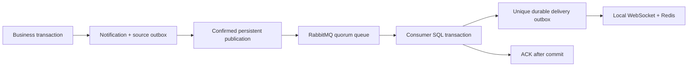

# RabbitMQ notification delivery

Notifications support RabbitMQ 4.3.7 using the RabbitMQ-maintained `amqp091-go` v1.15.0 client. The real MySQL/broker failure matrix is implemented and has run locally. A06 remains partially accepted: the remaining fault scenarios are listed below. Execution evidence belongs in [`PROGRESS.md`](../PROGRESS.md).

## Data flow and guarantees

The business transaction continues to write the notification inbox and `notification.created` outbox row together. In broker mode the outbox publisher sends a persistent, versioned event with its stable event key, mandatory routing and publisher confirms. Only a confirmed, routed publication can mark that source outbox row published.

The consumer validates the envelope against the committed source row and notification. Its transaction inserts a `notification.deliver` outbox row with unique key `broker-delivery:<source-event-key>`. This row is both the durable consumer effect and its deduplication record. The consumer ACKs only after commit. Redelivery after commit but before ACK finds the same row. The existing leased worker dispatches delivery rows to local sockets and Redis; these rows are never republished to RabbitMQ. No schema migration or second volatile task queue is needed.



Real-time delivery remains at least once. A delivery worker can send before losing its lease, so a later attempt can repeat a socket/Redis hint. SQL inbox/history remain authoritative. Consumer idempotency means one durable delivery row, not exactly-once WebSocket display.

## Queue and failure contract

One database uses one configured queue namespace. All its API workers must use the same broker configuration. The durable direct exchange routes to a bounded durable quorum queue. A durable quorum dead-letter queue is bound before source declaration. Source arguments select `reject-publish`, at-least-once dead lettering, a delivery limit of eight, and RabbitMQ 4.3's failed-delivery retry delay (one-second minimum, thirty-second maximum). A transient SQL failure uses `basic.reject(requeue=true)` so it counts as a failed delivery; malformed/conflicting events are rejected without requeue. A database failure must not be ACKed.

Publisher and consumer use separate connections. Publication has bounded network I/O and confirmation waits; uncertain outcomes are retried with the same event ID. Consumers reconnect and redeclare topology after disconnect. Startup with an unavailable broker leaves the HTTP API available and retries in the existing SQL outbox. `/ready` retains its database-only contract. SQL outbox attempts remain bounded at eight; dead SQL rows and broker dead letters require explicit operator replay after the cause is fixed.

SQLite without `RABBITMQ_URL` retains direct SQL-outbox dispatch for quick development. Compose enables broker delivery by default. A one-node Compose quorum queue survives a broker process restart but does not provide multi-node availability. Queue definitions are versioned names; changing immutable queue arguments requires an explicit queue migration. Deduplication rows must be retained while broker replay remains possible.

## Configuration and operations

| Setting | Behavior |
| --- | --- |
| `RABBITMQ_URL` | Optional `amqp://` or `amqps://` URI. Empty keeps direct SQL-outbox dispatch. Credentials are excluded from broker errors. |
| `RABBITMQ_QUEUE` | Defaults to `gostream.notifications.v1`; 1–100 ASCII letters, digits, dots, underscores or hyphens; cannot start with `amq.`. Use a separate namespace for each database. |
| `RABBITMQ_PASSWORD` | Compose broker password; the documented default is for local development. Override with a URL-safe generated value, for example hexadecimal. Existing RabbitMQ volumes retain their user credentials. |

Compose exposes AMQP on `127.0.0.1:5672` and management on `127.0.0.1:15672`. The broker data has its own named volume. The isolated object-test overlay removes broker host ports so it can run alongside the demo; APIs use the Compose network. Publisher and consumer connections have separate lifecycles; the application handles reconnects rather than enabling the client's experimental recovery feature. Shutdown cancels and joins workers before closing the publisher and database.

Monitor `gostream_rabbitmq_messages_total{result="published|accepted|duplicate|retry|dead|reconnect"}`, `gostream_rabbitmq_connected{role="publisher|consumer"}`, existing outbox metrics, queue depth and the `.dead` queue. The publisher connection gauge records its last observed state, not an active dependency probe. `accepted`/`duplicate` count committed consumer outcomes; a subsequent ACK failure can still cause redelivery. `dead` counts explicit invalid-event rejections; retry exhaustion is visible in the broker DLQ, not that counter.

Two `published_at` values have different meanings: a source row records confirmed broker acceptance; a delivery row records completion of the local/Redis dispatch attempt. Neither means a user has read or ACKed a WebSocket message. The SQL notification inbox is available independently of both.

After fixing a failed dependency or poison event, an operator can use the shipped executable:

```sh
# Reset exactly one dead, unpublished SQL event. Active/published rows are refused.
docker compose exec api /usr/local/bin/gostream-events -outbox-key notification:42

# Republish at most ten DLQ entries, confirm each publication, then ACK that entry.
docker compose exec api /usr/local/bin/gostream-events -dead-letters 10
```

Outside Compose, run `go run ./cmd/gostream-events` with the same flags. SQL replay requires explicit `DB_DRIVER` and `DB_DSN` for an existing migrated database; DLQ replay requires `RABBITMQ_URL` and the correct queue namespace. This is a local operator command, not a public HTTP endpoint. It does not migrate a database. Replaying a permanently invalid envelope sends it back to the DLQ, so inspect and fix the cause first. Interrupted replay can publish twice; the unique delivery key makes this safe for the durable effect. Replay does not reset an already completed delivery job, and intentionally does not remove deduplication records.

## Executed tests and reproduction

With Go 1.27.2 and a running MySQL 8.4 container whose internal environment contains `MYSQL_ROOT_PASSWORD`:

```sh
python3 tests/integration/rabbitmq_smoke.py \
  --go-bin /usr/local/go/bin/go \
  --mysql-container gostream-mysql-1 \
  --mysql-addr 127.0.0.1:3307
```

The script creates a random schema/user and a disposable RabbitMQ 4.3.7 container with explicit temporary host ports. It migrates the schema, runs `TestRabbitMQNotificationIntegration` with the race detector, builds and starts the real API, creates accounts/follow notification, checks automatic completion of both worker stages, sends SIGTERM and checks exit zero, and exercises both operator commands. Cleanup removes its broker, schema, user and temporary files. It never writes demo tables. Docker access and network access to pull the pinned image are required. CI's `rabbitmq-integration` job runs the same script against a dedicated MySQL service.

The real Go matrix checks:

- Confirmed publication before a missing SQL completion update, consumer commit before lost ACK, one delivery job and the actual WebSocket notification.
- Two consumers processing sixteen concurrent duplicate deliveries: one accepted effect and fifteen duplicates.
- An unbound mandatory route refusing source completion, followed by topology recovery.
- Invalid envelopes reaching a persistent quorum DLQ.
- A transient SQL failure recovering after delayed retry; persistent SQL failure exhausting its delivery limit and recovering through confirmed DLQ replay.
- Broker stop/start while a committed SQL event remains pending, followed by reconnection and delivery.

Direct Go invocation needs `GOSTREAM_TEST_RABBITMQ_URL` and `GOSTREAM_TEST_RABBITMQ_MYSQL_DSN` pointing to a dedicated migrated schema with an empty outbox. `GOSTREAM_TEST_RABBITMQ_CONTAINER` optionally names a **disposable** container the test is allowed to stop/start; without it, the restart subcase skips. The script supplies all three. Ordinary Go suites skip this matrix when external configuration is absent. SQLite unit tests separately cover strict envelopes, conflicting duplicates, rollback, cancellation, unavailable broker errors and targeted SQL replay.

The final local matrix passed all seven subcases in 48.12 seconds; API lifecycle and operator checks passed and cleanup reported zero remaining schemas/users. These are correctness timings, not a throughput benchmark. The first fixture failed because it asserted a deliberately hidden notification field; another attempt exposed Docker's randomly allocated host port changing on restart. The fixture now checks public notification fields and explicitly binds ports, retaining its state and recovery assertions.

## Remaining acceptance work

The smoke script additionally kills a real API after a committed follow request, restarts it and checks delivery, then drains five source events inserted while the API is stopped. This demonstrates general process restart and a small finite backlog. The kill is not gated on publisher-confirm/consumer-commit/ACK state; it may happen after delivery has completed. Sequential duplicate unit tests do not represent concurrent sustained load.

Actual producer/consumer kills at exact commit/confirm/ACK windows, unavailable/full DLQ targets, sustained backlog, multi-node quorum availability and the final combined MySQL/Redis/RabbitMQ/MinIO browser workflow remain unverified. No MQ throughput or exactly-once real-time delivery claim is made. Broker transport currently handles notifications; IM history/ACK and group hints retain SQL/Redis.

## Primary references

- [Publisher confirms in Go](https://www.rabbitmq.com/tutorials/tutorial-seven-go)
- [Consumer acknowledgements and confirms](https://www.rabbitmq.com/docs/confirms)
- [Quorum retry, delivery limits and at-least-once dead lettering](https://www.rabbitmq.com/docs/quorum-queues)
- [Pinned client release](https://github.com/rabbitmq/amqp091-go/releases/tag/v1.15.0)


## 2026-10-30 fault-test revision

New coverage pauses the isolated broker, observes a claimed/unpublished SQL event, kills/restarts the API and drains 50 finite events. The SQL claim is not proof of entry into a publisher-confirm wait. A separate test repeats a successful broker publication before SQL source completion, without claiming a real disconnect. The DLQ test now observes the production consumer reject the original poison while the target is unbound, restores the binding and checks that same ID before a second poison. It also fixes an erroneous `*gorm.DB != nil` check that previously made backlog polling always fail. Exact post-confirm/pre-SQL and consumer-commit/pre-ACK process-kill windows, sustained traffic and full DLQ remain outstanding.

Quorum at-least-once dead lettering is configured to retain messages until target confirmation; test scope follows the [RabbitMQ quorum queue documentation](https://www.rabbitmq.com/docs/quorum-queues#dead-lettering). Results require the actual broker CI, not SQLite unit tests.

The isolated test broker overrides `dead_letter_worker_publisher_confirm_timeout` to 1,000ms and verifies its actual application setting. Production RabbitMQ 4.3.7 defaults to 180,000ms; target recovery can wait for that retry timer. The test preserves original-message identity and keeps the target unbound across multiple short retries. This does not measure the production recovery latency. Source: [RabbitMQ 4.3.7 configuration](https://github.com/rabbitmq/rabbitmq-server/blob/v4.3.7/deps/rabbit/Makefile).


## 2026-10-31 三分支审核后的补充覆盖

`test/broker-fault-boundaries` 的有效增量在集成审核后保留并增强，不能据此删除上方待验项。

- `consumer_commit_pre_ack_disconnect_and_redelivery`：真实 AMQP Get 后调用生产持久接收方法提交 MySQL，再直接关闭底层 TCP，未发送 AMQP Close/ACK；新会话核对相同 ID/正文与 Redelivered 标志，再让生产消费者重投去重，检查 duplicate 指标、单一 SQL 行及停止消费者后的空队列。这是确定性的连接中断组件验证，未强杀生产 API。
- `confirmed_publish_before_sql_completion_retry`：确认发布后保留 SQL 未完成状态，重发相同 key 并核对去重指标。没有在真实生产者进程的 post-confirm/pre-SQL 时刻暂停或强杀。
- Go 混合矩阵：20 个独立有效事件通过两个 publisher 连接提交，5 个毒消息进入 DLQ；核对每个持久接收身份、全部互不重复的毒消息 ID、持久性与 rejected 原因。该用例验证接收，不单独宣称通知实时派发完成。
- Python API/worker 场景：在事务中准备 source 和可选去重行，source 已标记发送以免与后台发布者争抢；管理 API 发布后必须 routed=true。预提交去重场景检查生产消费者 duplicate 指标；混合场景并发发布 10 个独立有效 ID 和 3 个毒消息，逐 ID 检查实际 delivery 完成。检查全部 DLQ 身份/正文/原因后重新入队供运维 CLI，要求精确 replayed=3 及队列状态。夹具预置不等同于 pre-ACK 崩溃。
- SQLite 矩阵：32 次有效调用（16 个身份各重复两次）与 16 个毒消息同时启动；单连接串行写，检查 created/duplicate 各 16、毒消息拒绝、每个 SQL 身份恰一行。不能把单写池称为 MySQL 并行事务证明。

发布/消费精确进程强杀窗口、满 DLQ 与持续负载仍待完成；最终 MySQL/Redis/RabbitMQ/MinIO 联合配置也未关闭。真实组件执行以本次集成 PR 最终 CI 为准，未配置环境的本地跳过不算通过。
